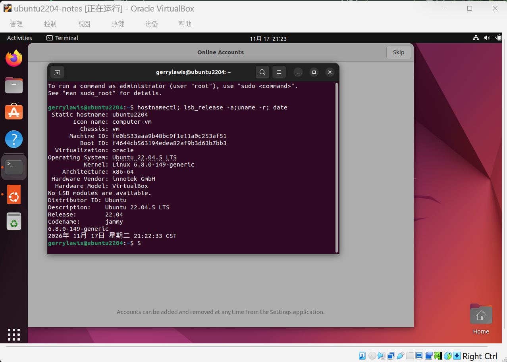
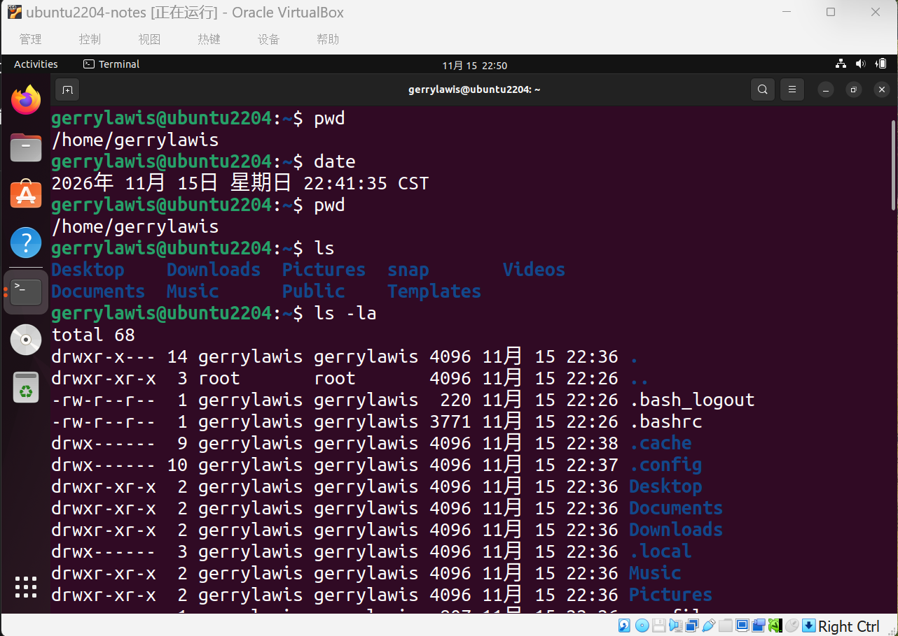
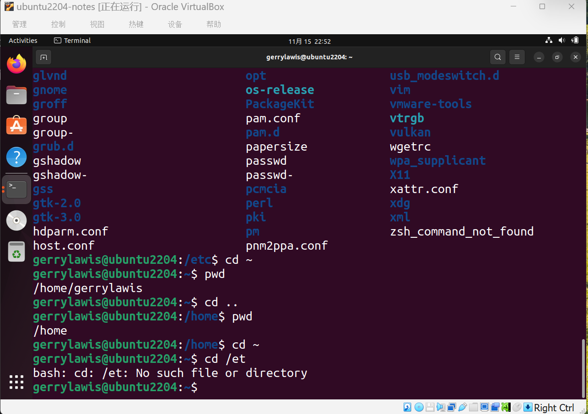
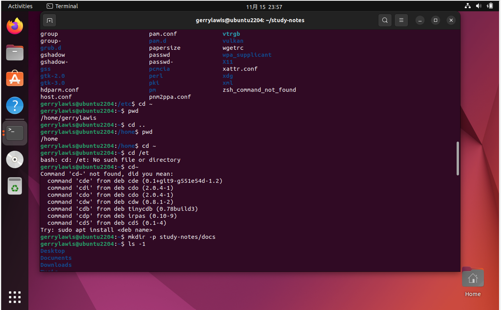
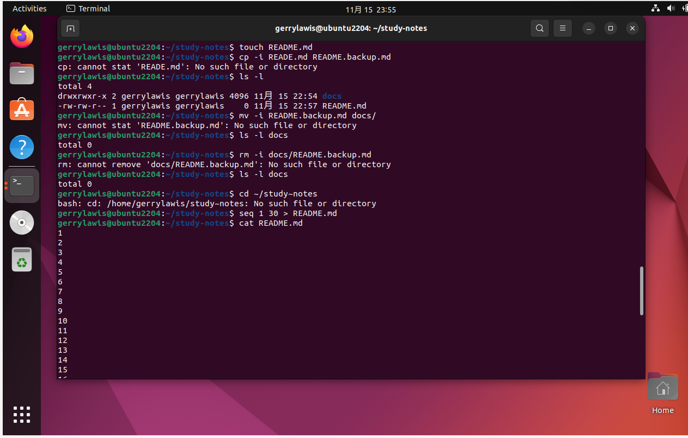
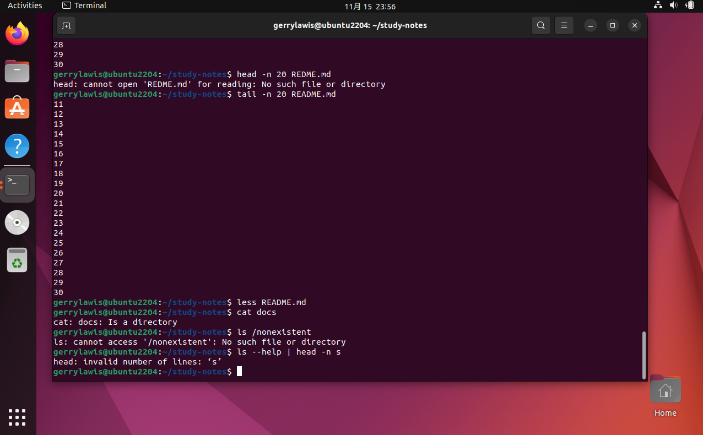
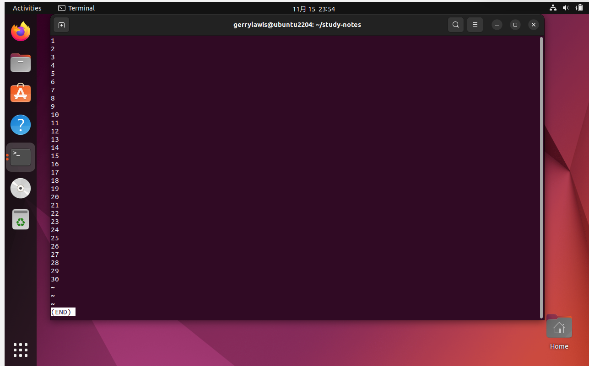
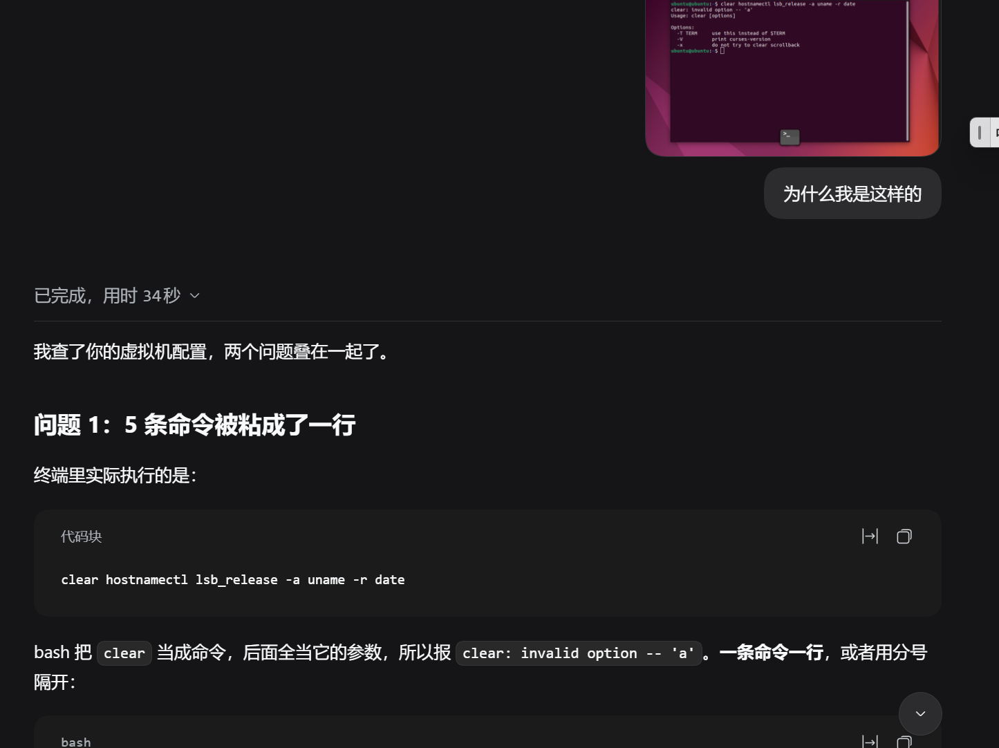
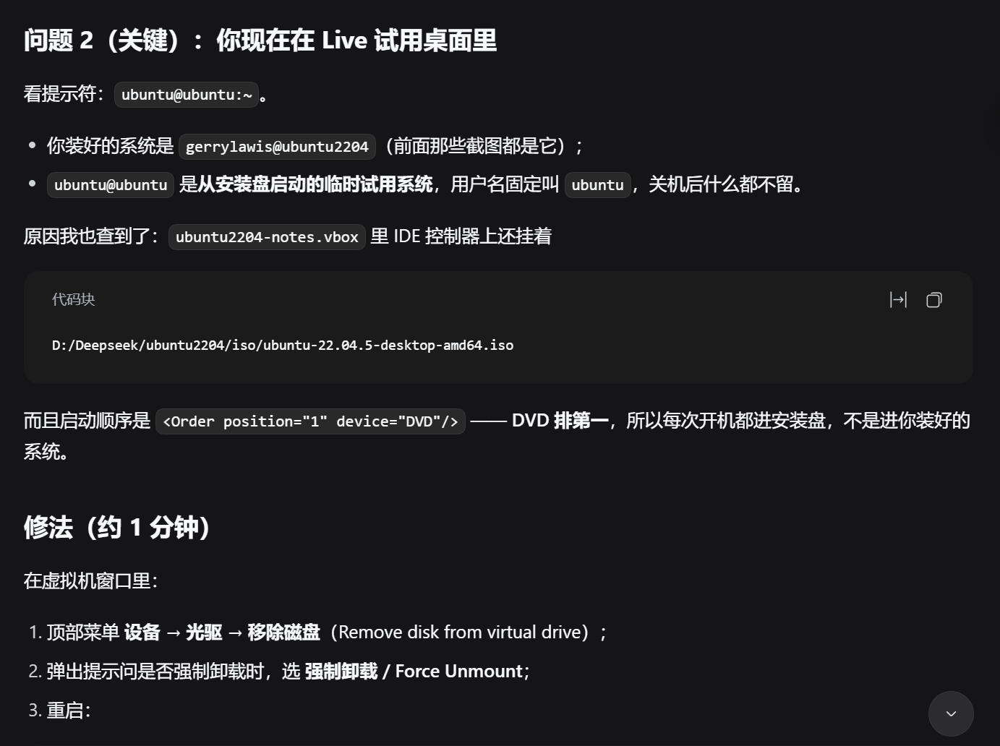
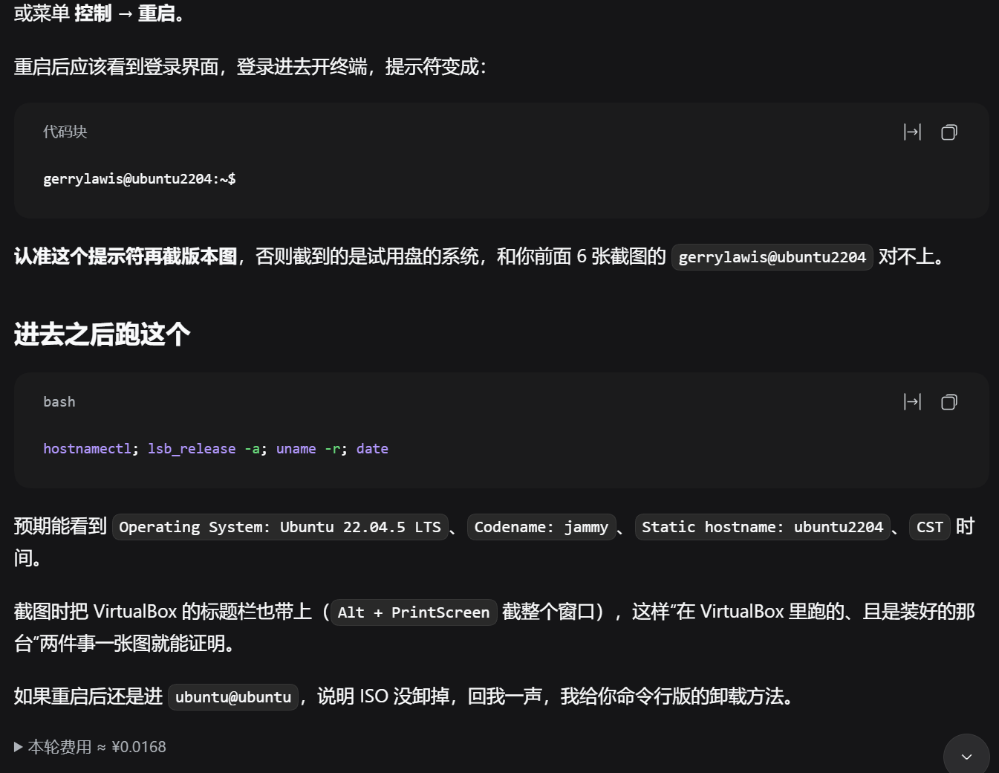

# 第二课作业：Ubuntu 22.04 环境搭建与常用命令练习

> 姓名：楼家瑞　　学号：1120253111　　日期：2026-11-17
> 课程：GitHub 分支协作与 Agent 实践

## 一、实验环境

| 项目 | 配置 |
|---|---|
| 宿主机系统 | Windows 11 家庭版（build 26200） |
| CPU / 内存 | AMD Ryzen 9 8940HX（16 核 32 线程）/ 15.2 GB |
| 虚拟化软件 | Oracle VirtualBox 7.2.8 |
| 客户机系统 | Ubuntu 22.04.5 LTS Desktop（代号 jammy） |
| 客户机内核 | Linux 6.8.0-149-generic |
| 主机名 / 用户名 | `ubuntu2204` / `gerrylawis`（家目录 `/home/gerrylawis`） |
| 虚拟机规格 | 4 GB 内存、2 个 CPU、25 GB 动态虚拟硬盘、NAT 网络 |
| 辅助工具（Agent） | DeepSeek Harness（DSH）编码 Agent，模型 deepseek-flash |

**Agent 在本次作业中的用途**：① 规划安装步骤并解释每一屏安装选项的含义；② 在我贴出报错信息或截图时定位问题原因；③ 把零散的截图按课程小节整理成目录并生成说明。



*环境证明：VirtualBox 中运行的 Ubuntu 22.04.5 LTS，主机名 `ubuntu2204`，`hostnamectl` 与 `lsb_release -a` 输出一致，时间为 CST。*

## 二、命令练习与截图

### 2.1 目录定位（`pwd` / `ls` / `ls -la` / `cd`）

`pwd` 打印当前所在路径；`ls` 只列名称，`ls -la` 额外显示权限、大小、修改时间和以 `.` 开头的隐藏文件；`cd` 切换目录，`cd ..` 回上一级，`cd ~` 回家目录。



*`pwd` 输出 `/home/gerrylawis`；`ls` 只列名称；`ls -la` 多出权限、大小、时间，并显示 `.bashrc`、`.config` 等隐藏文件。*



*`cd ~` 回到家目录、`cd ..` 退到 `/home`；最后一条 `cd /et` 漏打一个 c，终端返回 `No such file or directory`。*



*`cd /etc` 后提示符变为 `/etc$`；`cd /et` 报错说明路径要逐字符匹配；`cdˋ` 多打一个字符，终端提示 `Command 'cdˋ' not found` 并给出相近命令建议。*

### 2.2 文件操作（`mkdir` / `touch` / `cp` / `mv` / `rm`）

```bash
cd ~
mkdir -p study-notes/docs        # 一次建出两级目录
cd study-notes
touch README.md                  # 建空文件
cp -i README.md README.backup.md # 复制，覆盖前询问
mv -i README.backup.md docs/     # 移动
rm -i docs/README.backup.md      # 删除，删除前询问
```



*图中 `cp`、`mv` 报 `No such file or directory`，是因为我把 `README.md` 打成了 `README`（少一个字母 M）。报错直接指出源文件不存在，`ls -l` 也确认只有 `README.md` 一个文件；最后 `seq 1 30 > README.md` 写入内容并用 `cat` 验证成功。*

### 2.3 文本查看（`cat` / `less` / `head` / `tail`）

```bash
seq 1 30 > README.md   # 写入 1–30 行，方便对比 head 与 tail
cat README.md          # 一次输出全部
head -n 20 README.md   # 前 20 行（1–20）
tail -n 20 README.md   # 后 20 行（11–30）
less README.md         # 分页阅读，q 退出
```



*`tail -n 20` 显示 11–30；`head -n 20 REDME.md` 因文件名拼错（REDME）报错；`cat docs` 报 `Is a directory`——`cat` 只能读文件；`ls /nonexistent` 报路径不存在。*



*`less` 进入分页阅读界面，底部显示 `(END)`，按 `q` 返回命令行。*

| 报错 | 含义 |
|---|---|
| `cat: docs: Is a directory` | `cat` 只能读文件，不能读目录 |
| `ls: cannot access '/nonexistent': No such file or directory` | 路径不存在 |
| `head: invalid number of lines: 's'` | `-n` 后面要跟数字，我写成了字母 s |

## 三、遇到的问题与解决

| 问题现象 | 原因 | 解决办法 |
|---|---|---|
| 装完重启，又回到“试用 Ubuntu”桌面，提示符是 `ubuntu@ubuntu` | 安装 ISO 仍挂在虚拟光驱，且光驱排在启动顺序第一位，每次开机都从安装盘启动 | 虚拟机菜单 设备 → 光驱 → 移除磁盘（强制卸载），再重启，提示符恢复为 `gerrylawis@ubuntu2204` |
| 终端时间显示 14:14，和北京时间 22:14 差 8 小时 | 当时还在安装盘的试用桌面，时区仍是 UTC，且未安装到硬盘 | 在试用桌面上双击 Install Ubuntu 继续安装；装好后时区设为 Shanghai |
| 把 4 条命令粘成一行执行，报 `clear: invalid option -- 'a'` | 只有第一个词被当成命令，后面全部成了它的参数 | 一条命令一行，或用分号连接：`hostnamectl; lsb_release -a; uname -r; date` |
| `cp`、`mv`、`head` 报 `No such file or directory` | 文件名打错：`README`（少 M）、`REDME`（字母顺序错） | 先 `ls -l` 确认文件名，用 Tab 补全代替手打 |
| 鼠标点进虚拟机后出不来 | VirtualBox 会捕获鼠标 | 按右 Ctrl 释放 |
| 终端字号太小，截图看不清 | 默认字号偏小 | `Ctrl + Shift + +` 放大 |

## 四、Agent 辅助排错过程

排错的核心场景：装完系统重启后又回到“试用 Ubuntu”桌面，终端时间比北京时间慢 8 小时。把截图发给 Agent 后，它先判断现象、再查配置、最后给操作步骤。

**① 提问与第一个问题（命令被粘成一行）**



*我提问「为什么我是这样的」并附上终端截图；Agent 指出屏幕上 `clear hostnamectl lsb_release -a uname -r date` 被当成了一条命令，后面的全部成了 `clear` 的参数，所以报 `invalid option -- 'a'`。*

**② 第二个问题：当前在 Live 试用桌面（附判断依据）**



*Agent 指出提示符 `ubuntu@ubuntu` 是安装盘启动的临时系统；并读取 `ubuntu2204-notes.vbox`，确认 IDE 控制器上仍挂着 ISO，启动顺序为 `<Order position="1" device="DVD"/>`，所以每次开机都进安装盘。*

**③ 解决方案与验证方法**



*给出的操作：设备 → 光驱 → 移除磁盘（强制卸载）→ 重启；重启后提示符应变为 `gerrylawis@ubuntu2204`，再用 `hostnamectl; lsb_release -a; uname -r; date` 验证版本信息。按此操作后问题解决，即本文第一节的环境截图。*

## 五、心得体会

这次作业我在自己的笔记本上用虚拟机装了 Ubuntu 22.04，第一次把讲稿上的命令完整敲了一遍。Agent 帮我把安装和操作的一步步流程拆成可以照着做的步骤，在我贴出报错和截图时指出问题出在哪，最后帮我把十几张截图按章节归档。过程中最典型的问题是分不清“安装盘启动的试用桌面”和“装好的系统”：明明界面看起来一模一样，后来靠提示符 `ubuntu@ubuntu` 和 `gerrylawis@ubuntu2204` 的差别，还有大模型的提醒，才想明白每次开机都进了试用系统。还有一次把几条命令粘成一行，shell 把后面全当成第一个命令的参数，报错完全看不懂。我发现命令本身不难，难的是看懂提示符、路径和报错，还有发现错误并修正的能力。遇到问题先把现象描述清楚，在如今 AI 发展的时代，比反复盲目试要快得多。

## 六、文件目录

```
第二课作业：楼家瑞/
├─ README.md
├─ 环境/          环境-1_系统版本信息.png
├─ 目录定位/      目录定位-1 ~ -3（pwd / ls / ls -la / cd / cd .. / cd ~）
├─ 文件操作/      文件操作-1（mkdir / touch / cp / mv / rm）
├─ 文本查看/      文本查看-1 ~ -2（head / tail / cat / less / 报错示例）
└─ 排错过程/      排错过程-1 ~ -3（Agent 对话：提问、分析依据、解决方案）
```
